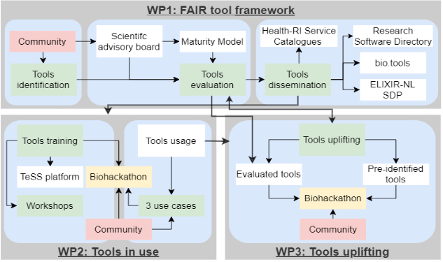
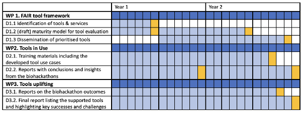

Researchers in the Life Sciences and Health (LSH) have many data tools and services to choose from, but it is often hard to find the right one or to judge its quality. As a result, good tools go unused, and similar tools get built again from scratch.

The **FAIR tool framework** project addresses this. Together with developers, experts, and users, we work on making tools and services developed in the Netherlands **Findable, Accessible, Interoperable, and Reusable**, both for the Dutch research community and internationally.

The project runs for two years and is funded by the [NWO](https://www.nwo.nl/en) Thematic Digital Competence Centre for Life Sciences & Health (**TDCC-LSH**).

How the project is organised

The work is split into three work packages (WPs). Each one tackles a different part of the problem, and they feed into each other:

- **WP1 – FAIR tool framework** finds tools, evaluates how mature they are, and makes the good ones easier to find.
- **WP2 – Tools in use** helps people actually use those tools, through use cases, training, and hands-on events.
- **WP3 – Tools uplifting** helps promising tools that are not quite there yet to become mature and sustainable.

Tools move between the work packages. WP1's evaluation decides which tools need training (WP2) or development support (WP3). Uplifted tools are evaluated again in WP1. What users run into in WP2 tells WP3 what to improve. Biohackathons, organised with the wider community, are where much of this comes together.

{#fig-wp-overview fig-alt="Diagram of the three work packages. WP1, FAIR tool framework: the community feeds tools identification; together with a scientific advisory board and the maturity model this leads to tools evaluation, and then to tools dissemination into Health-RI service catalogues, the Research Software Directory, bio.tools and the ELIXIR-NL service delivery plan. WP2, Tools in use: tools training, the TeSS platform, workshops, tools usage and three use cases, connected through a biohackathon with the community. WP3, Tools uplifting: evaluated tools and pre-identified tools are uplifted in a biohackathon with the community. Arrows link evaluation in WP1 to both WP2 and WP3, and back."}

WP1 – FAIR tool framework

**Goal:** make existing LSH tools and services easier to find and access, by evaluating them and sharing them with the wider user community.

**Identifying tools.** Through the ELIXIR Netherlands node institutes, we contact representatives from all major LSH domains to find tools and services developed or maintained in the Netherlands. We also search the scientific literature and code repositories, especially for emerging and promising tools.

**Evaluating tools.** With an advisory board of key stakeholders, we are developing a [maturity model](maturity-model.qmd) for tools and services. It builds on existing ELIXIR quality indicators, the ELIXIR Software Management Plan, and the Netherlands eScience Center's software sustainability guidelines. It looks at documentation, mentions and citations, reliability, interoperability, workflow integration, infrastructure compatibility, and sustainability. It also tries to keep the effort asked of developers reasonable.

**Sharing tools.** We combine existing metadata standards for research software into one description that maps onto several registries. That way a tool is catalogued once and appears in [bio.tools](https://bio.tools), the [Research Software Directory](https://research-software-directory.org), and the Health-RI One-Stop-Shop. Mature, sustainable tools are added to the ELIXIR Netherlands service portfolio and, where it makes sense, to [SURF Research Cloud](https://www.surf.nl/en/services/surf-research-cloud).

WP2 – Tools in use

**Goal:** help people adopt these tools by giving them the material they need to start using them.

**Use cases.** Together with domain experts, we develop three use cases from across the LSH field, covering green life sciences, biomolecular life sciences, and health sciences. Each one shows how a tool solves a concrete research problem.

**Training materials.** Built around those use cases, the materials include documentation, tutorials, troubleshooting guides, and runnable demonstrators with synthetic or real data. They are shared through ELIXIR's training portal [TeSS](https://tess.elixir-europe.org).

**Workshops and biohackathons.** Workshops, hands-on sessions, and biohackathons are shaped by what the different LSH communities tell us they need. They bring computational experts and domain researchers together, give feedback on tools and documentation, and reach new user communities. Later events check whether the training materials actually made a difference.

WP3 – Tools uplifting

**Goal:** raise the maturity and impact of promising tools and services through expert advice, training, and access to resources.

Tools selected in WP1 get support that fits how mature they are. This mostly happens at biohackathons, together with experts from SURF, the Netherlands eScience Center, and partner institutions. Typical improvements include:

- better software architecture, documentation, testing, version management, and CI/CD pipelines;
- making it easier for new developers to get started, with contribution guidelines and a code of conduct;
- software management and sustainability plans;
- making software FAIR and working well with FAIR data, by harmonising parameters and data formats;
- green computing: making software use computing resources efficiently.

The [uplifting guide](uplifting.qmd) collects this know-how so anyone can apply it to their own software. The [activities](activities.qmd) page shows where we have put it into practice.

Timeline

{#fig-wp-timeline fig-alt="Gantt chart spanning two years. WP1 deliverables: identification of tools and services (midway through year 1), a draft maturity model for tool evaluation (midway through year 2), and dissemination of prioritised tools (end of year 2). WP2 deliverables: training materials including the tool use cases (late year 2), and reports with insights from the biohackathons (end of year 1 and end of year 2). WP3 deliverables: reports on the biohackathon outcomes (late year 2) and a final report on the supported tools, highlighting key successes and challenges (end of year 2)."}

Who is involved

The project is driven by the communities of [ELIXIR Netherlands](https://www.health-ri.nl/elixir) and the Netherlands Bioinformatics and Systems Biology research school ([BioSB](https://www.dtls.nl/biosb/)), and supported by the Netherlands Research Software Engineers community ([NL-RSE](https://nl-rse.org)). Every partner institution takes part in all three work packages.

Partner institutions:

- Maastricht University
- Princess Máxima Center for Pediatric Oncology
- Leiden University Medical Center
- University Medical Center Groningen
- Vrije Universiteit Amsterdam
- Amsterdam UMC
- Wageningen University & Research
- Radboudumc
- Netherlands eScience Center
- SURF
- Health-RI

All project results and outcomes are made openly available. This website is open source; suggestions and corrections are welcome through the project's [GitHub repository](https://github.com/fair-toolbox/framework).

